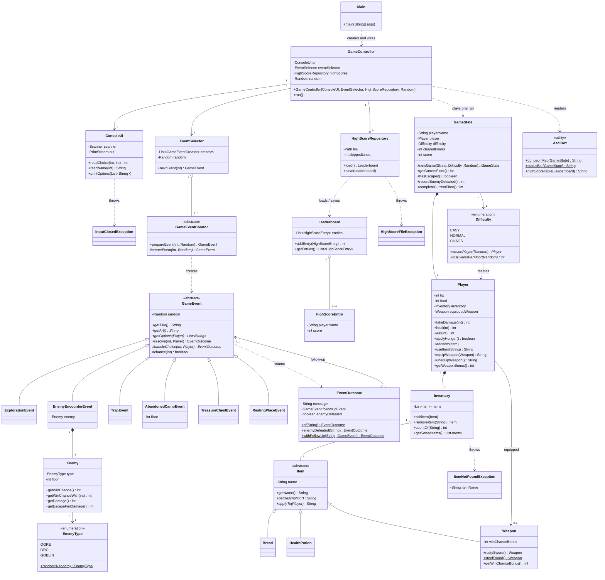
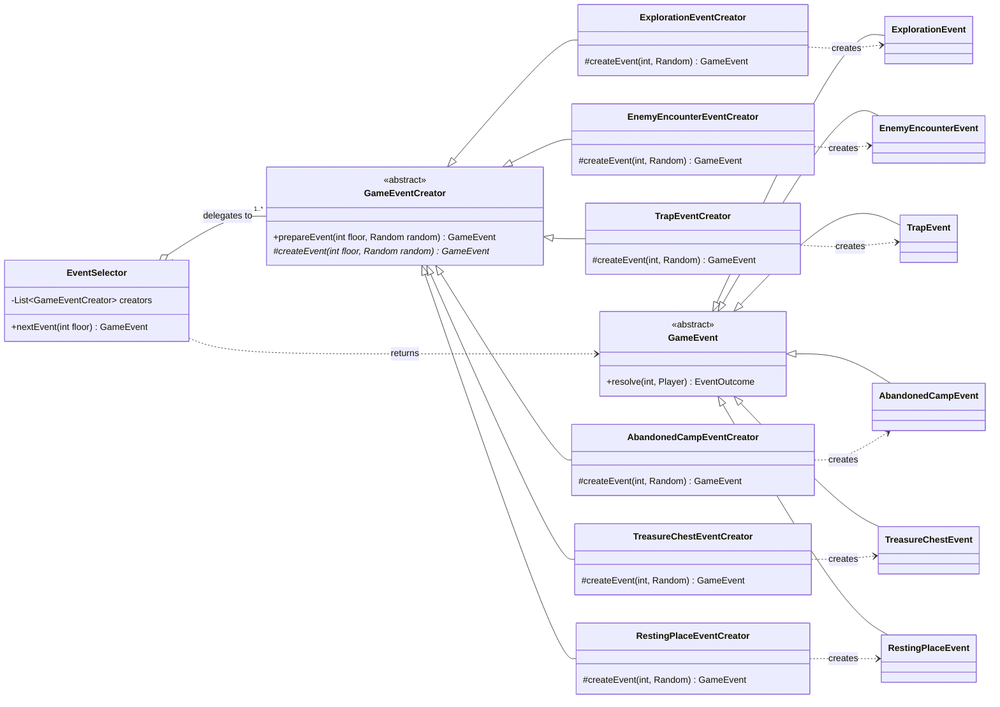

# UML Class Diagram

The diagrams are written in [Mermaid](https://mermaid.js.org/). GitHub renders them
directly, and the same text is the editable source.

Image versions (open in any web browser, no Mermaid support needed):
[class-diagram.svg](class-diagram.svg) (overview) and
[factory-method.svg](factory-method.svg) (Factory Method).
They were exported from the Mermaid source below; after changing the source, export them again.

Notation: `+` public, `-` private, `#` protected, `*` abstract method, `$` static.
Relationship arrows:

| Arrow | Meaning |
|---|---|
| `<\|--` | inheritance / extends |
| `*--` | composition (the part lives only inside the whole) |
| `o--` | aggregation (the whole holds parts that can exist on their own) |
| `-->` | association |
| `..>` | dependency (uses / creates / throws) |

Constants and getters are left out unless they matter for the design.

## 1. Overview

## 2. Factory Method in detail

`GameEventCreator` is the **Creator**, `GameEvent` the **Product**. Each concrete creator
overrides the factory method `createEvent()` and decides which concrete product is built.
`prepareEvent()` is the shared algorithm that calls the factory method.

## 3. Packages

| Package | Classes |
|---|---|
| `dungeon` | `Main` |
| `dungeon.controller` | `GameController` |
| `dungeon.domain` | `GameState`, `Difficulty`, `Player`, `Inventory`, `Item`, `Bread`, `HealthPotion`, `Weapon`, `ItemNotFoundException`, `Enemy`, `EnemyType`, `HighScoreEntry`, `Leaderboard` |
| `dungeon.event` | `GameEvent`, `EventOutcome` and the six concrete events |
| `dungeon.factory` | `GameEventCreator`, six concrete creators, `EventSelector` |
| `dungeon.persistence` | `HighScoreRepository`, `HighScoreFileException` |
| `dungeon.ui` | `ConsoleUI`, `AsciiArt`, `InputClosedException` |
